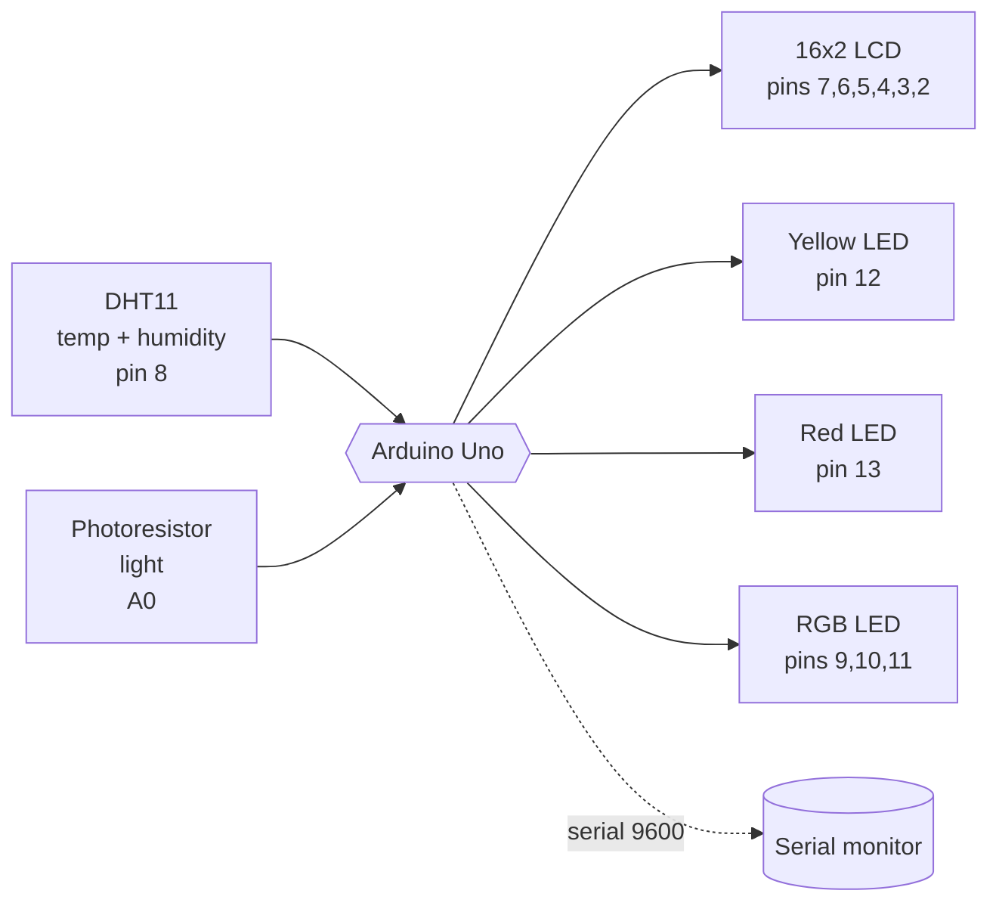

# 🌱 Huerto Digital

A tiny digital vegetable garden built on Arduino. It watches the conditions your plants care about (**temperature, humidity and light**) and shows them on an LCD, with LEDs that warn you when things get too hot or too dark.

```
            .-"""-.
           / .===. \          ☀
           \/ 6 6 \/
           ( \___/ )        \ | /
        ___ \_____/ ___    -- ☼ --
       /   \  |||  /   \     / | \
      | 🌿  |-|||-|  🌿 |
       \___/  |||  \___/
   ~~~~~~~~~~~|||~~~~~~~~~~~~~~~~~~~~~~~~~~
   ░░░░░░░░░░░|||░░░░░░░░░░░░░░░░░░░░░░░░░░   <- soil
   ▓▓▓▓▓▓▓▓▓▓▓▓▓▓▓▓▓▓▓▓▓▓▓▓▓▓▓▓▓▓▓▓▓▓▓▓▓▓▓▓▓▓
```

## What it does

Every 2 seconds the main sketch:

1. Reads temperature and humidity from a **DHT11** and light from a **photoresistor**.
2. Prints the values to the serial monitor (9600 baud).
3. Shows them on a 16x2 LCD:

```
┌────────────────┐
│ Temp  Hum  Luz │   <- labels, drawn once
│ 23C    45%  78%│   <- values, refreshed every 2 s
└────────────────┘
```

4. Lights up the alerts:

| Condition                     | Response            |
| ----------------------------- | ------------------- |
| Temperature ≥ 25 °C           | Yellow LED on       |
| Temperature ≥ 28 °C           | Red LED on          |
| Light reading below threshold | RGB LED turns cyan  |

If the DHT fails to read, the LCD shows an error and the sketch retries.

## How it fits together



## Wiring (main sketch)

| Part                | Pin(s)                                  |
| ------------------- | --------------------------------------- |
| LCD (RS, EN, D4–D7) | 7, 6, 5, 4, 3, 2                        |
| DHT11 data          | 8                                       |
| Photoresistor       | A0 (dark threshold 500)                 |
| Potentiometer       | A1 (declared, currently unused)         |
| Red LED             | 13                                      |
| Yellow LED          | 12                                      |
| RGB LED (PWM)       | 9, 10, 11                               |

## Sketches

| Folder                        | Purpose                                                                 |
| ----------------------------- | ----------------------------------------------------------------------- |
| `Huerto_Digital_Temperatura`  | **Main sketch**: DHT11 + photoresistor + LCD + LEDs                     |
| `Prueba_Buzzer`, `Prueba_Buzzer_2` | Early tests with an analog TMP36 sensor and a buzzer (no buzzer on the current board) |

## Build and upload

Requires [`arduino-cli`](https://arduino.github.io/arduino-cli/) and these libraries: `DHT sensor library`, `Adafruit Unified Sensor`, `LiquidCrystal`, plus the `arduino:avr` core.

```sh
arduino-cli compile --fqbn arduino:avr:uno Huerto_Digital_Temperatura
arduino-cli upload  --fqbn arduino:avr:uno -p COM5 Huerto_Digital_Temperatura
```

The board is an Uno-compatible one with an FTDI USB-serial chip, so it may show up as "Unknown" in `arduino-cli board list`. Adjust the COM port to match yours.

## Notes

- The DHT11 only measures **whole degrees**. For decimals, switch to a DHT22 (`#define DHTTYPE DHT22`).
- Light % is `map(analogRead(A0), 0, 1023, 0, 100)`.
- Code comments and on-screen text are in Spanish.
